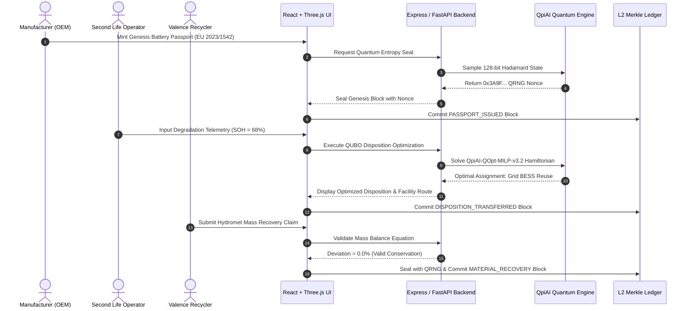

<div align="center">

# ⚡ REMIX CHAIN OF PROOF
### Enterprise Web3 EV Battery Passport, Disposition Optimization & QpiAI Engine

<p align="center">
  
</p>

<br/>

[](https://chain-of-proof.vercel.app/)
[](https://chain-of-proof.vercel.app/)
[](https://ais-dev-zur4riys5nqphdcthg5i2p-150209175765.asia-southeast1.run.app)
[](https://chain-of-proof.vercel.app/)

<br/>

[](https://chain-of-proof.vercel.app/)
[](https://chain-of-proof.vercel.app/)
[](https://chain-of-proof.vercel.app/)
[](https://chain-of-proof.vercel.app/)
[](https://chain-of-proof.vercel.app/)
[](LICENSE)

<br/>

> **Role-aware EV battery passport, disposition lifecycle tracking, and cryptographically verifiable material recovery audit platform powered by QpiAI Quantum Computing, QCloud 128-bit QRNG Nonces, and EU Battery Directive 2023/1542 Compliance Engines.**

[🌐 **Launch Live Demo**](https://chain-of-proof.vercel.app/) • [🛠️ **Open Dev Studio**](https://ais-dev-zur4riys5nqphdcthg5i2p-150209175765.asia-southeast1.run.app) • [📖 **Quantum Architecture**](#-qpiai-ecosystem-deep-dive) • [🧮 **Mass Conservation**](#-mass-conservation-audit-engine)

---

</div>

<br/>

## 🌟 Executive Overview & Strategic Value

Under the **EU Battery Directive 2023/1542** and global ESG compliance mandates, OEMs, second-life operators, and recyclers must prove origin, degradation telemetry, second-life cascade history, and physical recovery efficiency of critical minerals (Lithium, Nickel, Cobalt, Manganese).

**Remix Chain of Proof** unites the physical telemetry of electric vehicle battery packs with:
1. **QpiAI Opt QUBO Optimization**: Solves optimal End-of-Life (EoL) cascade decisions (Direct Grid BESS Reuse vs. Commercial Repurposing vs. Hydrometallurgical Recycling) in under 90ms.
2. **QpiAI QCloud 128-bit QRNG**: Stamps every state transition, diagnostic update, and recovery claim with true non-deterministic quantum entropy measured from Hadamard state superpositions.
3. **Interactive 3D Digital Twin**: High-fidelity Three.js WebGL visualizer rendering real-time State-of-Health (SOH), cell thermal gradients, exploded pack architecture, and impedance metrics.
4. **Verifiable Mass Conservation Engine**: Reconciles physical black mass output against genesis chemical bills of materials to eliminate false greenwashing recovery claims.
5. **Tamper-Evident L2 Merkle Ledger**: Interactive cryptographic chain inspector featuring live tamper injection and instant 1-click self-repair verification.

---

## 🚀 Industrial-Scale USPs vs. Legacy Systems

| Capability | Legacy Battery Systems | Chain of Proof + QpiAI Platform |
| :--- | :--- | :--- |
| **3D Asset Inspection** | Static 2D diagrams / PDFs | **Interactive Three.js Digital Twin** with exploded module breakdown, real-time heatmaps, and cell degradation telemetry |
| **EoL Cascade Decisioning** | Subjective heuristics / Manual sorting | **QpiAI Opt QUBO Solver (`QpiAI-QOpt-MILP-v3.2`)** evaluating SOH, impedance, thermal risk, and metal spot prices in <90ms |
| **Cryptographic Randomness** | Deterministic pseudo-random seeds (PRNG) | **QCloud 128-bit Quantum Nonces** derived from real Hadamard basis qubit superposition measurements |
| **Material Mass Audit** | Self-reported spreadsheets / Paper manifests | **Algorithmic Mass Conservation Engine** auditing $M_{\text{in}} = M_{\text{out}}$ with strict $\le 5\%$ tolerance guards |
| **Refining Logistics** | Static geographic allocation | **Stage 2 QUBO Multi-Facility Fleet Dispatch** optimizing transport $\text{CO}_2$ emissions and processing fees |
| **Data Integrity Verification** | Vulnerable centralized SQL databases | **Cryptographic L2 Merkle SHA-256 Ledger** with live tamper simulation and 1-click automated chain repair |
| **Regulatory Compliance** | Fragmented manual compliance reporting | **Automated EU Battery Directive 2023/1542** passport genesis, role-based data views, and audit exports |

---

## 🔮 QpiAI Ecosystem Deep Dive

```
 ┌─────────────────────────────────────────────────────────────────────────────────────────────┐
 │                                QPIAI QUANTUM & OPTIMIZATION PIPELINE                        │
 ├─────────────────────────────────────────────────────────────────────────────────────────────┤
 │                                                                                             │
 │   ┌─────────────────────────────────────────────────────────────────────────────────────┐   │
 │   │                              1. QPIAI QCLOUD HARDWARE                               │   │
 │   │  • 128-bit Quantum Random Number Generator (QRNG) powered by Hadamard Superposition │   │
 │   │  • Nonce: 0x3A9F810C928378EF910A887C19283711 injected into Solidity smart contracts  │   │
 │   └──────────────────────────────────────────┬──────────────────────────────────────────┘   │
 │                                              │                                              │
 │                                              ▼                                              │
 │   ┌─────────────────────────────────────────────────────────────────────────────────────┐   │
 │   │                           2. QPIAI OPT SDK & QUBO SOLVER                            │   │
 │   │  • QpiAI-QOpt-MILP-v3.2 Hybrid Quantum-Classical Heuristic Optimization Engine       │   │
 │   │  • Stage 1: Battery EoL Cascade Matrix (Direct Reuse vs. Repurpose vs. Recycle)      │   │
 │   │  • Stage 2: Multi-Facility Supply Chain & Hydromet Fleet Dispatch Optimization     │   │
 │   └──────────────────────────────────────────┬──────────────────────────────────────────┘   │
 │                                              │                                              │
 │                                              ▼                                              │
 │   ┌─────────────────────────────────────────────────────────────────────────────────────┐   │
 │   │                            3. QPIAI UNIFIED HYBRID BACKEND                          │   │
 │   │  • Express + FastAPI REST API proxy with deterministic hardware & simulation modes  │   │
 │   │  • Live API endpoints: /api/qubo/disposition, /api/qubo/dispatch, /api/quantum/nonce │   │
 │   └─────────────────────────────────────────────────────────────────────────────────────┘   │
 └─────────────────────────────────────────────────────────────────────────────────────────────┘
```

### 1. Mathematical Formulation: QpiAI Opt QUBO Solver
The platform formulates End-of-Life (EoL) cascade allocation as a **Quadratic Unconstrained Binary Optimization (QUBO)** problem mapped to an Ising spin Hamiltonian:

$$\min_{x \in \{0,1\}^n} \quad H(x) = \sum_{i=1}^{n} Q_{ii} x_i + \sum_{1 \le i < j \le n} Q_{ij} x_i x_j$$

#### Stage 1: Battery EoL Cascade Disposition Model
For each degraded battery pack $k$, binary decision variables represent:
* $x_{k,1} \in \{0,1\}$: Direct Grid BESS Second-Life Reuse
* $x_{k,2} \in \{0,1\}$: Repurpose to Commercial Backup / EV Light Mobility
* $x_{k,3} \in \{0,1\}$: Hydrometallurgical Material Recycling

$$\text{Subject to the exclusivity constraint:} \quad \sum_{m=1}^{3} x_{k,m} = 1 \quad \forall k$$

The diagonal weight matrix $Q_{ii}$ penalizes and rewards assignments based on:
* **State of Health ($\text{SOH}_k$)** and Remaining Useful Life ($\text{RUL}_k$)
* **Internal Impedance ($\Delta R_{\text{internal}}$)** and Thermal Runaway Vulnerability
* **Market Spot Prices**: Current spot rates for $\text{Li}_2\text{CO}_3$, $\text{NiSO}_4$, and $\text{CoSO}_4$

#### Stage 2: Multi-Facility Fleet Dispatch Model
Allocates bulk batches of retired batteries to authorized hydrometallurgical refiners $\mathcal{F} = \{\text{Alpha}, \text{Beta}, \text{Gamma}\}$, minimizing logistical transportation emissions and processing charges:

$$\min \quad \sum_{f \in \mathcal{F}} \left( C_{\text{transport}}(d_f) \cdot m_{\text{batch}} + C_{\text{refine},f} \cdot m_{\text{batch}} \right) \quad \text{s.t.} \quad \text{Load}_f \le \text{Capacity}_f$$

---

### 2. QCloud 128-bit Quantum Random Number Generator (QRNG)
Deterministic pseudo-random seeds leave blockchain ledgers open to hash manipulation. Chain of Proof injects non-deterministic quantum entropy by preparing single-qubit Hadamard superposition states:

$$|\psi\rangle = H|0\rangle = \frac{1}{\sqrt{2}}\left(|0\rangle + |1\rangle\right)$$

Collapsing 128 qubits via projective measurement generates an authentic 128-bit quantum nonce formatted as a 32-character hexadecimal string (`0x...`). This nonce is enforced inside our Solidity smart contract:

```solidity
// Deep Security Guard: Enforcing QpiAI QCloud 128-bit QRNG Nonce on Ledger State
function updateBatterySOH(
    string memory batteryId,
    bytes32 _dataHash,
    string memory _qpiaiNonce
) external onlyAuthorized {
    // Reverts if transaction lacks non-deterministic QCloud quantum seal
    require(bytes(_qpiaiNonce).length > 0, "SECURITY: MISSING QRNG NONCE");
    
    batteryHistory[batteryId].push(BatteryUpdate({
        dataHash: _dataHash,
        qpiaiNonce: _qpiaiNonce,
        timestamp: block.timestamp
    }));
    
    emit SOHUpdated(batteryId, _dataHash, _qpiaiNonce);
}
```

---

## 👥 Industry Persona Architecture & Dynamic RBAC

Chain of Proof features dynamic **Role-Based Access Control (RBAC)** that adapts the entire navigation suite, authorization clearances, and data redactions in real time:

```
                            ┌───────────────────────────┐
                            │   CHAIN OF PROOF SYSTEM   │
                            └─────────────┬─────────────┘
                                          │
           ┌──────────────────────────────┼──────────────────────────────┐
           │                              │                              │
           ▼                              ▼                              ▼
  ┌──────────────────┐          ┌──────────────────┐          ┌──────────────────┐
  │MANUFACTURER (OEM)│          │ SECOND LIFE OPER │          │RECYCLER (VALENCE)│
  ├──────────────────┤          ├──────────────────┤          ├──────────────────┤
  │• Mint Passports  │          │• Ingest SOH      │          │• Hydromet Batches│
  │• Chemistry BOM   │          │• QUBO Cascade    │          │• Black Mass Audit│
  │• QCloud QRNG     │          │• Dispatch Route  │          │• Settle Claims   │
  └──────────────────┘          └──────────────────┘          └──────────────────┘
```

### 1. Manufacturer (OEM)
* **Clearance**: Genesis battery passport minting, proprietary cathode recipe hashing, baseline BOM declaration.
* **Redaction Protection**: Proprietary chemical formulas are visible only to the OEM; downstream recyclers receive strictly sanitized material ratios.
* **Authorized Modules**: `Dashboard`, `Passport Studio`, `Chain Explorer`.

### 2. Second-Life Operator
* **Clearance**: SOH degradation logging, thermal diagnostic review, QUBO cascade solver optimization.
* **Operational Goal**: Extends pack economic value by matching packs $\ge 65\%$ SOH into commercial BESS grids.
* **Authorized Modules**: `Dashboard`, `Passport Studio`, `Disposition Console`, `Chain Explorer`.

### 3. Recycler (Valence Refiner)
* **Clearance**: Hydromet batch intake, recovery yield logging, material conservation validation.
* **Audit Responsibility**: Proves recovery efficiency to regulators without exposing manufacturer trade secrets.
* **Authorized Modules**: `Dashboard`, `Recycling Hub`, `Reconciliation`, `Chain Explorer`.

---

## 🧮 Mass Conservation Audit Engine

Under the **EU Battery Directive 2023/1542**, recyclers must guarantee minimum recovery rates (e.g., $\ge 95\%$ for Cobalt and Nickel, $\ge 80\%$ for Lithium by 2026). Chain of Proof enforces an automated algorithmic mass conservation solver:

$$M_{\text{Pack Total}} = M_{\text{Lithium}} + M_{\text{Nickel}} + M_{\text{Cobalt}} + M_{\text{Manganese}} + M_{\text{Slag/Black Mass}} + \Delta M$$

$$\text{Deviation Percentage } (\delta) = \left| \frac{M_{\text{Claimed}} - M_{\text{Genesis Baseline}}}{M_{\text{Genesis Baseline}}} \right| \times 100\%$$

* **$\delta \le 5.0\%$**: **VALIDATED** &mdash; Stamped with an immutable QCloud QRNG verification seal.
* **$\delta > 5.0\%$**: **REJECTED / FLAGGED** &mdash; Immediately locks the claim and alerts the audit compliance console.

---

## 🖥️ Interactive Module Overview

```
 ┌───────────────────────┬────────────────────────────────────────────────────────────────────────┐
 │ MODULE                │ CORE CAPABILITIES                                                      │
 ├───────────────────────┼────────────────────────────────────────────────────────────────────────┤
 │ 📊 Dashboard          │ Real-time fleet KPIs, active battery counts, QpiAI status, role switch │
 │ 🪪 Passport Studio    │ 3D Digital Twin, EU-compliant timeline, SOH metrics, redacted BOM view │
 │ ⚡ Disposition        │ QUBO weight slider matrix, 2-stage QpiAI solver, fleet dispatch routing│
 │ ♻️ Recycling Hub      │ Hydrometallurgical batch tracker, black mass yields, ESG metrics       │
 │ ⚖️ Reconciliation    │ Mathematical mass conservation solver, claim auditor, deviation guards │
 │ ⛓️ Chain Explorer     │ Merkle block viewer, SHA-256 hash chains, 1-click tamper and repair    │
 └───────────────────────┴────────────────────────────────────────────────────────────────────────┘
```

---

## ⛓️ Interactive Cryptographic Tamper & Repair Demo

To demonstrate zero-trust auditability, the **Chain Explorer** features a live **Tamper Simulation Engine**:

1. **Inject Tamper**: Modifies an intermediate block's payload (e.g., alterations to historical SOH).
2. **Immediate Cascade Failure**: SHA-256 Merkle links downstream break immediately ($H_{i} \neq \text{prevHash}_{i+1}$), triggering an instant system-wide red security alert.
3. **1-Click Cryptographic Repair**: Re-verifies all hashes against the authoritative state and regenerates canonical Merkle tree proofs.

---

## ⚙️ System Architecture & Data Flow



---

## 📡 REST API Specification

| Method | Endpoint | Description | Key Parameters |
| :--- | :--- | :--- | :--- |
| `GET` | `/api/dashboard/summary` | High-level fleet metrics, active claims, recent events | Headers: `x-actor-role` |
| `GET` | `/api/passports` | List all battery passports with role-aware data redaction | Headers: `x-actor-role` |
| `GET` | `/api/passports/:id` | Fetch specific passport, redacted BOM, and historical events | `id` (e.g., `BAT-001`) |
| `POST` | `/api/passports/:id/events` | Record diagnostic SOH update sealed with QCloud QRNG | `event_type`, `payload` |
| `POST` | `/api/quantum/nonce` | Generate a 128-bit Hadamard QRNG nonce directly | None |
| `POST` | `/api/qubo/disposition` | Solve EoL cascade disposition matrix using QpiAI QUBO | `batteryIds: string[]` |
| `POST` | `/api/qubo/dispatch` | Solve logistics routing to hydrometallurgical refiners | `batchMassKg`, `batchChemistry` |
| `GET` | `/api/qubo/scale-test` | Run high-concurrency optimization test on 100+ packs | `num_batteries` |
| `POST` | `/api/reconciliation/claim` | Audit mass balance claim against genesis baseline | `batchId`, `materialType`, `claimedKg` |
| `GET` | `/api/ledger/blocks` | Retrieve full L2 Merkle ledger block array | None |
| `GET` | `/api/ledger/verify` | Cryptographically verify integrity of all block hashes | None |
| `POST` | `/api/ledger/tamper` | Simulate malicious alteration on Block #1 | None |
| `POST` | `/api/ledger/repair` | Restore canonical cryptographic hash chain | None |

---

## 🛠️ Local Developer Setup

### Prerequisites
* **Node.js**: `v20.0.0` or higher
* **npm**: `v10.0.0` or higher

### Quickstart

```bash
# 1. Clone the repository
git clone https://github.com/your-org/chain-of-proof.git
cd chain-of-proof

# 2. Install dependencies
npm install

# 3. Configure environment variables (optional for simulation mode)
cp .env.example .env

# 4. Start full-stack development server (Express API + Vite Dev Server)
npm run dev
# Express API & Vite UI available at http://localhost:3000

# 5. Build for production
npm run build
```

---

## 🎨 Visual Design System

* **Color Palette**:
  * **Primary Aubergine**: `#2A1B24` (Deep industrial container contrast)
  * **Surface Silver**: `#EAEBEE` (Clean Scandinavian architectural backdrop)
  * **Accent Amber / Marigold**: `#F59E0B` (High-visibility action cues & highlights)
  * **Cobalt Blue**: `#3B82F6` (Cryptographic hash badges & verification states)
  * **Emerald Green**: `#10B981` (Validated status & healthy SOH markers)
* **Typography**:
  * Clean UI & Body: `Inter`, system-ui, sans-serif
  * Cryptographic Hashes, Nonces & JSON Data: `JetBrains Mono` / Monospace
* **Motion & Animation**: Micro-interactions powered by `framer-motion` and Three.js orbit controls.

---

## 📜 Compliance & Regulatory Standards

* **EU Battery Directive 2023/1542**: Conforms to Digital Battery Passport mandates, carbon footprint tracking, and minimum recycled material thresholds.
* **ISO 26262**: Functional safety diagnostic data architecture for automotive systems.
* **IEEE 2413**: Architectural framework for Internet of Things (IoT) battery pack telemetry.

---

<div align="center">

### ⚡ LIVE STATUS: ONLINE
**[🌐 Launch Live Application](https://chain-of-proof.vercel.app/)** • **[🛠️ Access Dev Studio](https://ais-dev-zur4riys5nqphdcthg5i2p-150209175765.asia-southeast1.run.app)**

*Crafted for sustainable circular EV battery value chains powered by QpiAI Quantum Computing.*

[▲ Back to Top](#-remix-chain-of-proof)

</div>
